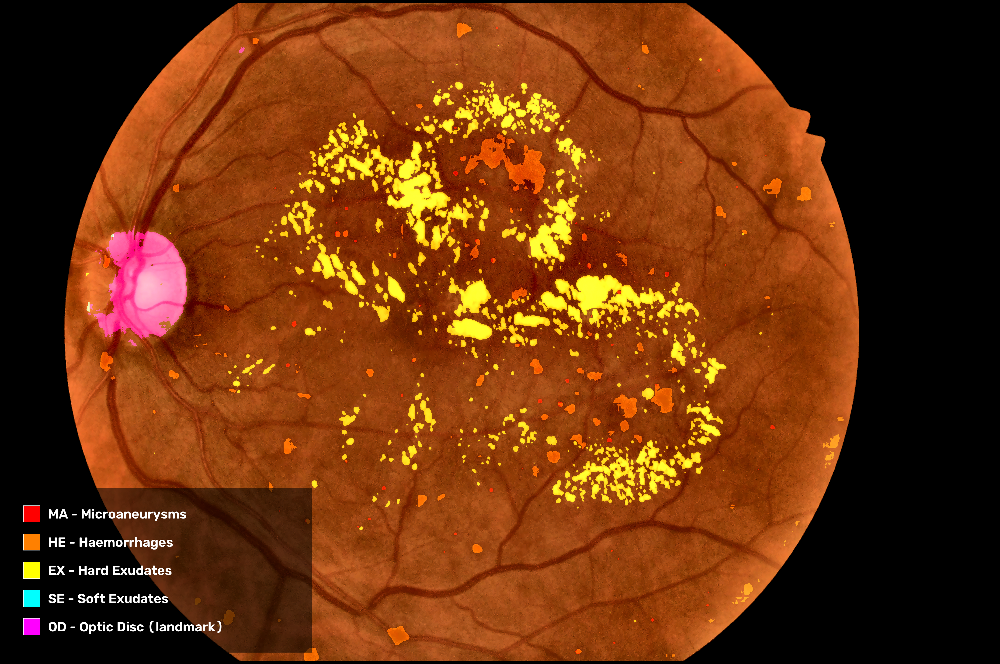

# Diabetic Retinopathy Lesion Segmentation (IDRiD + UNet)

A deep learning pipeline that looks at an eye (fundus) photo and **marks the exact pixels** where signs of diabetic retinopathy (DR) appear.

It finds 5 things:

| Short name | What it is | Why it matters |
|---|---|---|
| **MA** | Microaneurysms | Tiny bulges in blood vessels. The earliest sign of DR. |
| **HE** | Haemorrhages | Small patches of bleeding in the retina. |
| **EX** | Hard Exudates | Yellow fat/protein deposits leaking from vessels. |
| **SE** | Soft Exudates | Fluffy white patches (cotton-wool spots). |
| **OD** | Optic Disc | The bright circle where the nerve leaves the eye. Not a disease, but useful as a landmark. |

This is called **segmentation**: instead of saying "this eye has DR", the model draws a coloured map showing *where* each lesion is.

---

## 1. The big picture

```
Raw eye photo (4288 x 2848)
        |
        v
 [1] ENHANCEMENT        fix lighting, boost contrast, remove noise
        |
        v
 [2] DATASET PREP       cut into small patches (e.g. 256x256) + matching masks
        |
        v
 [3] TRAINING           UNet learns "which pixels are lesions?"
        |
        v
 [4] PREDICTION         new photo in -> coloured lesion overlay out
```

Each step has its own file, so you can read and understand them one at a time.

---

## 2. Project files

| File | What it does (simple version) |
|---|---|
| `enhancement.py` | Cleans up the eye photo so lesions are easier to see. |
| `prepare_dataset.py` | Reads the raw IDRiD dataset, enhances it, cuts it into training-ready pieces. |
| `dataset.py` | Loads those pieces into PyTorch, and randomly flips/rotates them (augmentation). |
| `model.py` | The UNet neural network itself. |
| `losses.py` | Measures how wrong the model is, and calculates Dice scores. |
| `train.py` | The training loop. Teaches the model and saves checkpoints. |
| `predict_tiled.py` | **Recommended inference.** Runs the model over a full-size photo using a sliding window and saves a coloured overlay with a legend. |
| `predict.py` | Simple inference that shrinks the whole image first. Only suitable for models trained in `full` mode. |
| `doctor_upload_pipeline/` | The original MATLAB image-quality and enhancement pipeline that `enhancement.py` was ported from (see section 7). |
| `result.png` | Example output overlay. |
| `requirements.txt` | Python libraries needed. |

---

## 3. Step-by-step: how each part works

### Step 1: Enhancement (`enhancement.py`)

Fundus photos are messy: some parts are too dark, some too bright, and there is camera noise. We fix this in 4 small steps:

1. **FOV mask.** Finds the round retina area and ignores the black corners around it. (FOV = field of view.)
2. **Illumination normalisation.** Blurs the image heavily to estimate the "background light", then subtracts it. This evens out dark and bright regions.
3. **CLAHE.** A contrast booster applied only to brightness (the L channel in LAB colour), so colours do not go weird. Lesions become easier to spot.
4. **Denoising.** Uses OpenCV's Non-Local Means to smooth out grain without blurring edges too much.

Finally, everything outside the retina is set to black.

> This is a Python port of an earlier MATLAB pipeline (`doctor_upload_pipeline`). The idea is that training images are processed the same way as images the system will see later.

### Step 2: Dataset preparation (`prepare_dataset.py`)

The raw IDRiD images are huge (4288 x 2848). Microaneurysms are only about 2 to 5 pixels wide. If we simply shrink the whole image to 512 x 512, **most microaneurysms disappear**. So there are two modes:

| | `full` mode | `patch` mode (recommended) |
|---|---|---|
| Idea | Shrink the whole image to 512x512 | Cut the full-size image into small tiles (e.g. 256x256) |
| Tiny lesions (MA/HE) | Mostly lost | Preserved |
| Number of samples | ~54 | Hundreds |
| Best for | Quick test that the code runs | Real training and results |

**How patch mode works:**
- Enhance the full-size image first (no shrinking).
- Slide a square window across it (this project's model was trained with **256x256 patches and a stride of 192**, so tiles overlap). Both numbers can be changed with `--patch_size` and `--stride`.
- Skip tiles that are mostly black (outside the retina).
- Most tiles have no lesions at all. Keep only **15%** of those (`--bg_keep_ratio`), so the model does not just learn "everything is background".
- For each tile, save the image plus 5 black-and-white mask files (one per lesion type).

If a lesion mask file is missing for an image (for example, no soft exudates), it is treated as an all-black mask. That is correct, since no file means no lesion.

The official IDRiD **Training Set** becomes `train`, and the **Testing Set** becomes `val`.

### Step 3: The model (`model.py`)

The model is a **UNet**, a classic network for pixel-wise tasks.

```
Input patch (3 x H x W, e.g. 256 x 256)
   |
 Encoder  -> shrinks the image step by step, learning "what is in here?"
   |
 Bottleneck
   |
 Decoder  -> grows back to full size, learning "where exactly?"
   |        (skip connections copy fine detail from the encoder)
   v
Output (5 x H x W): one map per lesion type
```

- 4 down-steps and 4 up-steps.
- The skip connections are the key trick: they carry sharp edges and tiny details across, which matters for small lesions.
- The output is **logits** (raw scores). Sigmoid is applied later, in the loss and in prediction.
- Each of the 5 outputs is independent, so one pixel can belong to more than one class (multi-label).
- `--base_features 32` controls model size. Use `16` if your laptop runs out of memory.

### Step 4: Loss and metrics (`losses.py`)

Lesion pixels are **very rare** (MA is far below 1% of a patch). If we only used normal BCE loss, the model could score 99% accuracy by predicting "nothing" everywhere.

So we combine two losses:

- **BCE** (binary cross entropy): judges every pixel.
- **Dice loss**: directly rewards overlap between the prediction and the real lesion, no matter how small it is.

`Loss = 0.5 x BCE + 0.5 x Dice`

**Dice score** is how we measure quality. It goes from 0 (no overlap) to 1 (perfect overlap). It is reported **separately for each lesion type**, because an average would hide the fact that MA is much harder than OD.

### Step 5: Training (`train.py`)

What happens each epoch:
1. Run through all training patches, compute the loss, update the model.
2. Run through all validation patches (no learning), compute loss and Dice per class.
3. Save `checkpoints/last.pt` (always) and `checkpoints/best.pt` (if validation loss improved).

Settings used:
- Optimiser: Adam, learning rate `1e-4`
- Scheduler: halves the learning rate if validation loss doesn't improve for 4 epochs
- Augmentation (training only): random horizontal/vertical flips, 90-degree rotations, and slight brightness change
- Device: auto-picks NVIDIA GPU (CUDA), then Apple GPU (MPS), then CPU
- `--resume checkpoints/last.pt` continues after an interruption

### Step 6: Prediction

There are two prediction scripts. **Use `predict_tiled.py` for any model trained in `patch` mode.**

**`predict_tiled.py` (recommended).** It does at test time what training did:

1. Enhance the new photo at full native resolution (no shrinking).
2. Slide a window across it (same patch size as training, overlapping by the stride).
3. Run the model on each window, a few at a time.
4. Average the overlapping predictions into one full-size probability map per lesion.
5. Apply a threshold (default 0.5) and draw the coloured overlay, plus a legend box in the corner.

**`predict.py` (simple, limited).** It shrinks the whole image to 512x512 and runs the model once. That re-creates the "tiny lesions disappear" problem, so it only makes sense for models trained with `--mode full`.

Overlay colours:

| Colour | Lesion |
|---|---|
| Red | MA |
| Orange | HE |
| Yellow | EX |
| Cyan | SE |
| Magenta | OD |

Both scripts also print how many pixels were flagged for each lesion type.



*Example overlay produced by the prediction script.*

---

## 4. How to run it

### 4.1 Setup (once)

```bash
python -m venv venv

# Windows (PowerShell)
venv\Scripts\Activate.ps1
# Mac/Linux
source venv/bin/activate

pip install -r requirements.txt
```

### 4.2 Download the dataset

Download **"A. Segmentation"** from the official IDRiD challenge page. It is the small subset (~81 images) that has pixel-level lesion masks. The code expects this folder layout:

```
A. Segmentation/
  1. Original Images/
    a. Training Set/IDRiD_01.jpg ...
    b. Testing Set/IDRiD_55.jpg ...
  2. All Segmentation Groundtruths/
    a. Training Set/
      1. Microaneurysms/IDRiD_01_MA.tif
      2. Haemorrhages/IDRiD_01_HE.tif
      3. Hard Exudates/IDRiD_01_EX.tif
      4. Soft Exudates/IDRiD_01_SE.tif
      5. Optic Disc/IDRiD_01_OD.tif
    b. Testing Set/  (same layout)
```

> The dataset is **not included** in this repo (large size, and it has its own licence).

### 4.3 Prepare the data

```bash
python prepare_dataset.py --raw_root "path/to/A. Segmentation" --out_root ./prepared_dataset --mode patch --patch_size 256 --stride 192 --bg_keep_ratio 0.15
```

This is slow on a laptop (denoising full-size images). For a quick smoke test, use `--mode full`.

### 4.4 Train

```bash
python train.py --data_root ./prepared_dataset --epochs 40 --batch_size 4 --base_features 32
```

Tips:
- Out of memory? Try `--base_features 16 --batch_size 2`.
- No GPU? Training on CPU works but is slow. Google Colab's free GPU is a good option: upload `prepared_dataset/` and run the same command.

### 4.5 Predict

```bash
python predict_tiled.py --image path/to/fundus.jpg --checkpoint checkpoints/best.pt --base_features 32 --patch_size 256 --stride 192 --out result.png
```

`--patch_size` and `--base_features` must match what you used for preparing the data and training. Lower `--batch_size` if you run out of memory.

---

## 5. Known limitations (please read)

Being honest about these is part of good ML work:

1. **Use the right prediction script.** `predict.py` shrinks the whole image, which does not match a patch-trained model. Use `predict_tiled.py` for patch-trained models.
2. **No separate test set.** The IDRiD "Testing Set" is used as validation, and the best checkpoint is picked using it. So reported Dice scores are slightly optimistic.
3. **Very small dataset.** Only ~54 training images. Even with hundreds of patches, they come from the same photos, so overfitting is a real risk. Watch the gap between train loss and val loss.
4. **MA and HE are hard.** Expect low Dice for these at first. EX and OD usually improve fastest.
5. **Not a medical device.** This is a research/learning project. It must not be used for real diagnosis.

---

## 6. Ideas for future work

- Mask predictions to the retina area (field of view) in `predict_tiled.py`
- Proper train / validation / test split by image
- Pre-trained encoder (e.g. ResNet or EfficientNet backbone)
- Grad-CAM or lesion overlays inside a screening web app
- Pinned library versions in `requirements.txt`
- Saving the LR scheduler state when resuming

---

## 7. The MATLAB pipeline (`doctor_upload_pipeline/`)

This is the earlier project that the Python enhancement code was ported from. It was built to check and clean up photos that a doctor uploads. By its file names it is organised like this:

- `CORE_FUNCTIONS/`: the building blocks. Quality scores (blur, contrast, field of view, illumination, combined in `assessQuality.m`) and enhancement steps (`getFOVMask`, `illuminationNormalize`, `applyCLAHE`, `denoiseImage`, combined in `enhanceImage.m`).
- `IMAGE_PATH/`: processing a single image for prediction.
- `VIDEO_PATH/`: processing a video for prediction, and building a montage to review frame quality.
- `ENTRY_POINT/process_doctor_upload.m`: the main function that ties it together.

`enhancement.py` reproduces the enhancement chain so that training images are processed in the same way as images the MATLAB pipeline will later pass to the model. One difference: the Python version resizes label masks in sync with the image, so the labels never drift out of alignment.

---

## 8. Tech stack

Python, PyTorch, OpenCV, NumPy, SciPy, tqdm (plus MATLAB for the original quality pipeline)

## 9. Dataset credit

IDRiD: Indian Diabetic Retinopathy Image Dataset (ISBI 2018 challenge). Please cite the original authors if you use the data.

## 10. Licence

Add a licence of your choice (e.g. MIT) before making the repo public.